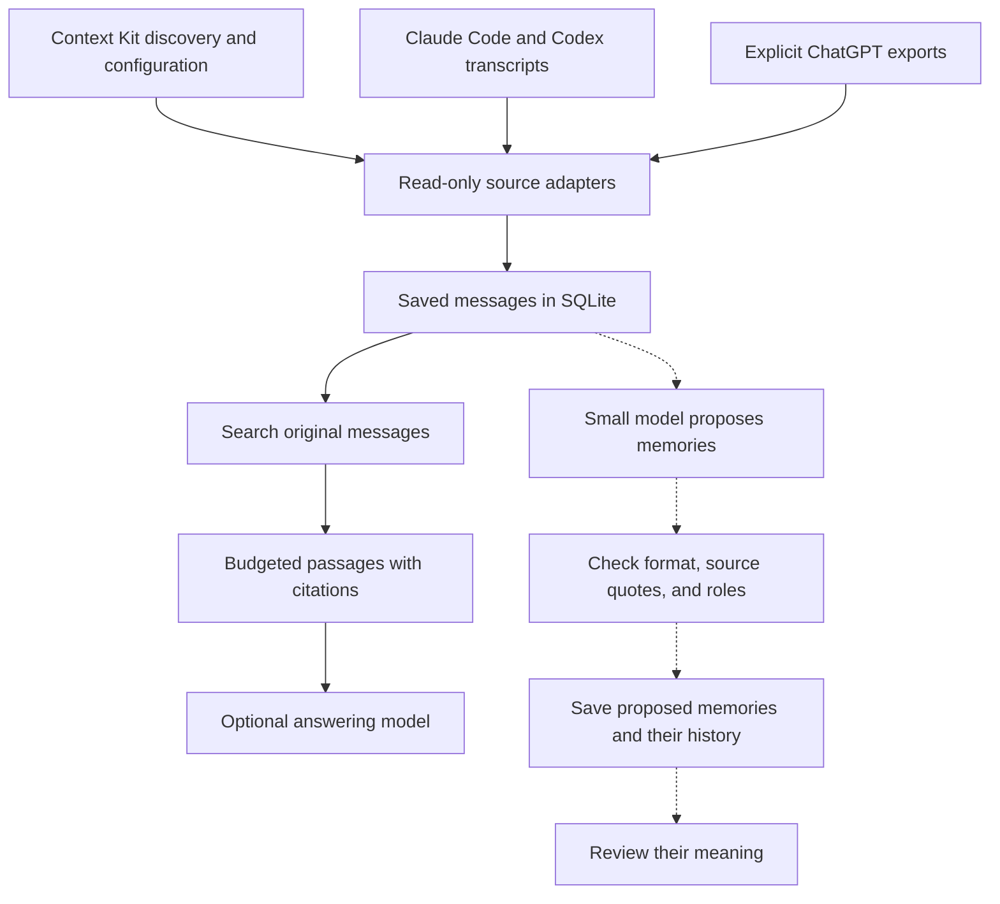

# TraceMem

TraceMem searches past conversations and returns the original messages, with
citations. The research goal is to train a small model to extract useful facts
and decisions without losing who said them, when they applied, or how certain
the speaker was.

Someone might say, “I might try SQLite,” then later, “I chose SQLite.” A memory
system must preserve that difference and point back to both messages. The
current tool finds the source; interpreting the change remains experimental.

**The local search tool works today; no research model has been selected for
product use.** We trained Qwen3-4B as a verifier on fictional examples. It kept
all six supported development claims but still labeled two of six unsupported
claims as supported, so it failed its primary criterion. The small dev set has
provisional, agent-only labels. See the
[paired-verifier results](docs/verifier-pairs-model-results.md) and frozen
[protocol](docs/verifier-pairs-model-protocol.md). These results do not show
QA benefit, extraction recall, or generalization.

Earlier extraction and verifier experiments remain documented in the
[quote-v4 results](docs/sft-quote-v4-results.md), [quote verifier results](docs/quote-verifier-dev-results.md),
[prompt baseline](docs/quote-baseline-results.md), [quote-v2 results](docs/sft-quote-v2-results.md),
and [pilot results](docs/sft-pilot-results.md). The four extractor runs and
their findings are unchanged by the verifier experiment.

This run used only newly authored fictional cases; no private conversation
was included in its training or evaluation data or uploaded. Some owner agent
logs were inspected locally for transcript-reader checks only; they were not
model data. Real conversations remain local searchable evidence, and claims
still need source review. See [data governance](docs/data-governance.md).

## What works

- Read-only Claude Code and Codex transcript adapters, plus an explicit
  ChatGPT JSON export reader.
- SQLite keeps speaker roles, text versions, and source locations.
- Keyword search (BM25), vector search, or a combination. Default vectors are
  deterministic and need no model download.
- Complete passages keep their citations when packed for a consumer.

## Evidence flow



The solid arrows show local search; the dotted arrows show model experiments.
Context Kit helps locate sources and stays unchanged. Citations let someone
check the original words; a claim may still be wrong. Proposed memories are
kept for review and do not feed search yet.

## Run the synthetic demo

Python 3.11+ and SQLite with FTS5 are enough. The demo and benchmark use
fictional data and run without an API key or model download.

The demo asks “Where is the quarterly planning meeting?” and retrieves “The
quarterly planning session is in room Juniper, on the fourth floor.” with its
source citation.

```sh
make demo
make benchmark
```

To ingest a local transcript and search its evidence, use a private database
path such as `.local/evidence.sqlite3`:

```sh
mkdir -p .local
PYTHONPATH=src python3 -m tracemem ingest \
  --provider codex --input /path/to/session.jsonl --db .local/evidence.sqlite3
PYTHONPATH=src python3 -m tracemem search \
  --db .local/evidence.sqlite3 --query "What did we decide?" --mode hybrid
```

Keep private source data and derived evidence local. See [data governance](docs/data-governance.md)
for handling rules.

## Read more

- [Project status and design](docs/project-status.md) describes the working
  boundary and research gates.
- [Latest QA review results](docs/qa-controls-review-results.md) reports the
  current fictional review and its limits.
- [Data governance](docs/data-governance.md) covers private-source handling
  and release gates.
- [Documentation index](docs/README.md) groups implementation notes,
  experiments, and validation records.

Code and authored synthetic examples use the [MIT License](LICENSE).
