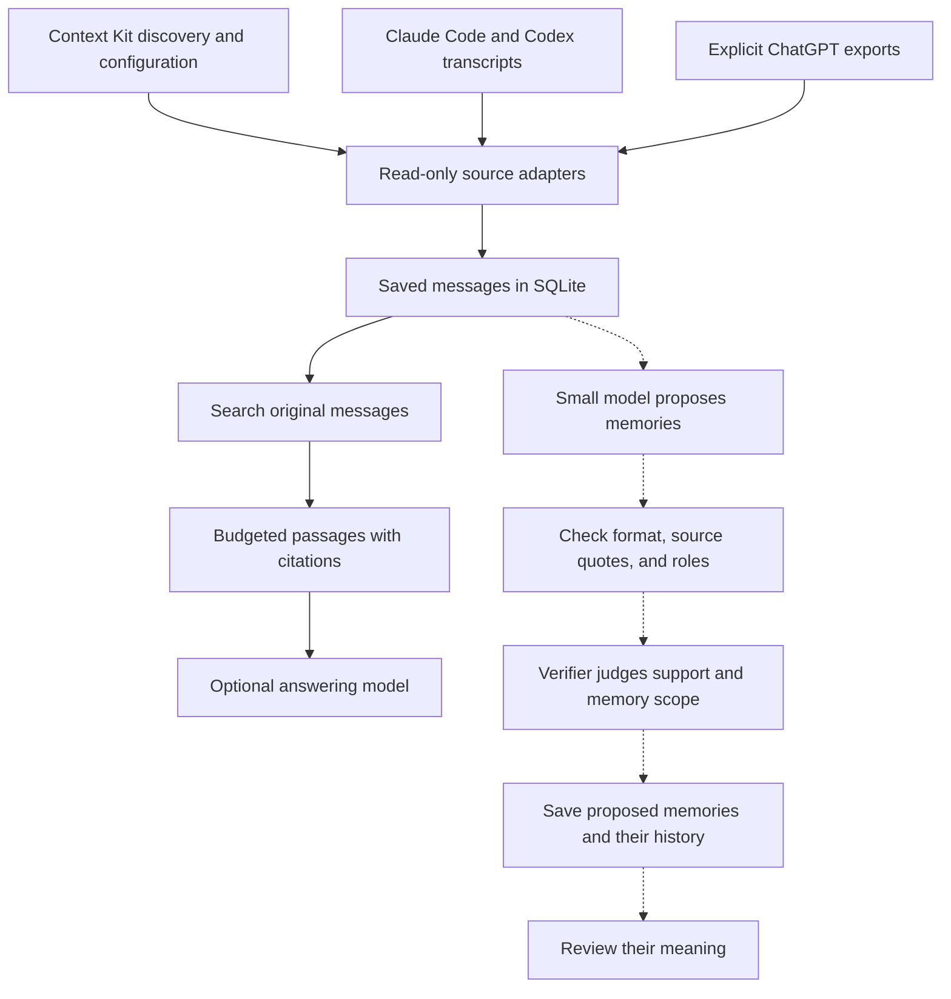

# TraceMem

TraceMem searches past conversations and returns the original messages, with
citations. The research goal is to train a small model to extract useful facts
and decisions without losing who said them, when they applied, or how certain
the speaker was.

Someone might say, “I might try SQLite,” then later, “I chose SQLite.” A memory
system must preserve that difference and point back to both messages. The
current tool finds the source; interpreting the change remains experimental.

**Local search works today; trained memory models remain research.** A
balanced-support recovery run completed, but both predeclared development gates
failed on small, adaptive sets with provisional agent labels and no human review.
The first launch had failed during runtime setup; a later recovery produced
scored results. No model was selected. See the [recovery results](docs/balanced-support-results.md),
[experiment index](docs/README.md), and [data notes](docs/realistic-data.md).

A separate inference-only challenge on 16 fictional candidates across eight
scripted scenarios passed its narrow dev gate, but both adapters got 0/2
uncertain-support cases right. Labels remain provisional; this is not product
evidence and does not change the failed private-training gate. See the
[naturalistic dev results](docs/naturalistic-dev-results.md).

## What works

- Read-only Claude Code and Codex transcript adapters, plus an explicit
  ChatGPT JSON export reader.
- SQLite keeps speaker roles, text versions, and source locations.
- Keyword search (BM25), vector search, or a combination. Default vectors are
  deterministic and need no model download.
- Complete passages keep their citations when packed for a consumer.

## Evidence flow



Conversation facts live in the local evidence store. Training teaches the model
how to judge a claim against the original messages. The current verifier takes
a supplied claim and its evidence, then reports whether it is supported and
whether its subject belongs in personal memory. Extraction and answering are
separate experiments.

The solid arrows show local search; the dotted arrows show model experiments.
Context Kit helps locate sources and stays unchanged. Citations let someone
check the original words; a claim may still be wrong. Proposed memories are
kept for review and do not feed search yet.

## Run the synthetic demo

Python 3.11+ and SQLite with FTS5 are enough. The demo and benchmark use
fictional data and run without an API key or model download.

The demo asks “Where is the quarterly planning meeting?” and retrieves “The
quarterly planning session is in room Juniper, on the fourth floor.” with its
source citation.

```sh
make demo
make benchmark
```

To ingest a local transcript and search its evidence, use a private database
path such as `.local/evidence.sqlite3`:

```sh
mkdir -p .local
PYTHONPATH=src python3 -m tracemem ingest \
  --provider codex --input /path/to/session.jsonl --db .local/evidence.sqlite3
PYTHONPATH=src python3 -m tracemem search \
  --db .local/evidence.sqlite3 --query "What did we decide?" --mode hybrid
```

Keep private source data and derived evidence local. See [data governance](docs/data-governance.md)
for handling rules.

## Read more

- [Project status and design](docs/project-status.md) describes the working
  boundary and research gates.
- [Latest QA review results](docs/qa-controls-review-results.md) reports the
  current fictional review and its limits.
- [Data governance](docs/data-governance.md) covers private-source handling
  and release gates.
- [Documentation index](docs/README.md) groups implementation notes,
  experiments, and validation records.

Code and authored synthetic examples use the [MIT License](LICENSE).
