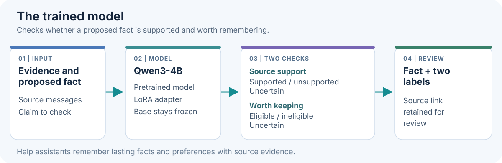
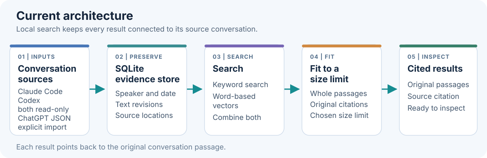
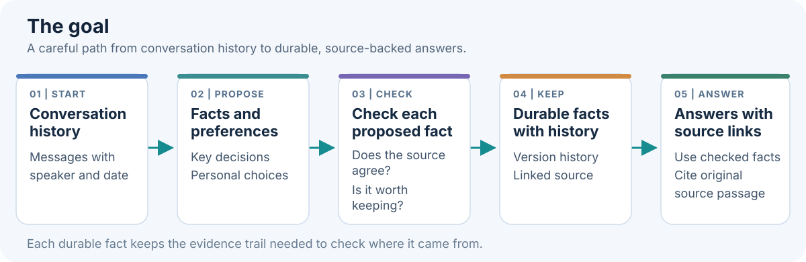

# TraceMem

*Find the passage. Keep the source.*

TraceMem explores how assistants can remember lasting facts and preferences with evidence from conversation history. It pairs local, source-cited retrieval with a separate trained model that checks proposed facts.

[The trained model](#the-trained-model) · [Local search](#local-search) · [Benchmark snapshot](#benchmark-snapshot) · [Quick start](#quick-start) · [The goal](#the-goal) · [Documentation](#documentation)

## The trained model

We fine-tuned **Qwen3-4B**, a pretrained language model with about 4 billion parameters. **LoRA** trains a small adapter with about 33 million weights while keeping the base model fixed. The latest training pass used 256 newly authored fictional examples for one epoch and 64 optimizer steps, on one NVIDIA A10G in about 5.5 minutes. Benchmark conversations were reserved for evaluation.

For each proposed fact, the model returns two separate judgments:

1. **Source support:** supported, unsupported, or uncertain.
2. **Worth keeping:** eligible, ineligible, or uncertain under the owner's policy of remembering durable facts and preferences.

The intended use is to help assistants carry forward lasting preferences together with their original evidence.

**Illustrative example (not model output):** “I prefer concise weekly updates” is a lasting preference; “Make this week's update concise” could be a one-time request.



## Local search

The local tool imports Claude Code and Codex transcripts in read-only mode, plus explicit ChatGPT JSON exports. SQLite keeps messages, dates, and their history. Search finds passages by keywords, vectors, or both, then returns whole passages with citations.

Local search retrieves cited passages; the separate model experiment checks proposed facts against source messages.



A fictional demo asks, “Where is the quarterly planning meeting?” TraceMem returns, “The quarterly planning session is in room Juniper, on the fourth floor,” with a citation to the source passage.

## Benchmark snapshot

The October 23, 2026 claim-checking test uses selected public benchmark evidence: 120 claims across 30 conversation families and 40 sessions. Labels were agent-reviewed under the owner's policy: remember durable facts and preferences. The support measure is the share of accepted claims supported by their source; useful-claim retention is reported separately.

| Measure | Base model | Trained candidate |
| --- | ---: | ---: |
| Source support among accepted claims | 66/78 (84.6%) | 58/61 (95.1%) |
| Useful reference claims retained | 28/28 | 28/28 |

See the [benchmark snapshot](docs/benchmark-snapshot.md) for the evaluation and training details, and the [experiment archive](docs/README.md#experiments-and-model-research) for earlier research.

## Quick start

Install [uv](https://docs.astral.sh/uv/getting-started/installation/) once. It sets up Python 3.12 for you.

```sh
git clone https://github.com/1337mus/tracemem.git
cd tracemem
uv run --python 3.12 tracemem demo
uv run --python 3.12 tracemem benchmark
```

The demo uses fictional messages and Python's built-in SQLite. No API key or model download is needed.

For local transcript ingestion and search, see [the source adapter and ingestion notes](docs/README.md#source-adapters-and-ingestion) and [data governance](docs/data-governance.md).

## The goal

The design goal is to keep durable facts and preferences with their source history, then help a future assistant answer with evidence it can point back to.



## Documentation

- [Documentation index](docs/README.md) for implementation notes, experiments, and historical reports.
- [Data governance](docs/data-governance.md) for local source handling.
- [MIT License](LICENSE).
