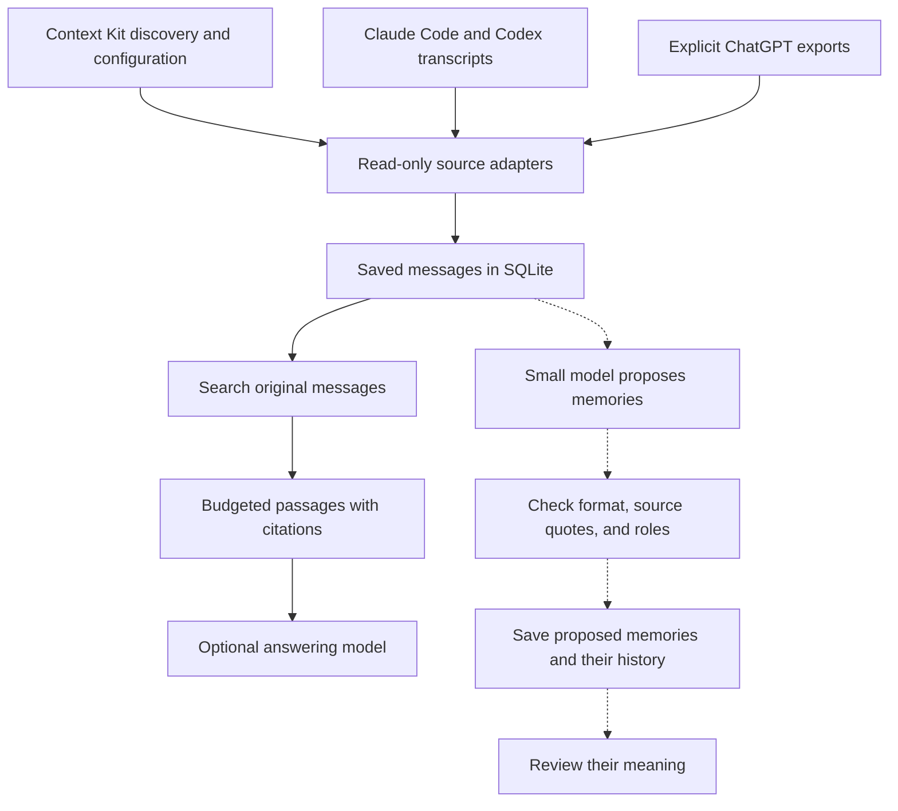

# TraceMem

TraceMem searches past conversations and returns the original messages, with
citations. The research goal is to train a small model to extract useful facts
and decisions without losing who said them, when they applied, or how certain
the speaker was.

Someone might say, “I might try SQLite,” then later, “I chose SQLite.” A memory
system must preserve that difference and point back to both messages. The
current tool finds the source; interpreting the change remains experimental.

**The local search tool works today. Three fiction-only SFT runs have trained
adapters, but no model has been validated or selected for product use.**

The latest model made fewer unsupported or ambiguous statements on our
fictional test, but left out more important facts. It failed the experiment's
success criteria. AI agents reviewed the results; no human review has happened.
See the [results report](docs/sft-quote-v3-results.md) for the counts and
limitations.
The earlier [quote-v2](docs/sft-quote-v2-results.md) and
[pilot](docs/sft-pilot-results.md) results remain documented.

All three adapters trained on newly written fictional conversations. We
inspected a sample of the owner's real agent logs locally to check the transcript readers,
but those logs were not training data and have not been evaluated with the
trained extractor. The model has not learned the owner's personal history. Real
conversations belong in the searchable evidence store; training is intended
to teach the model how to read them accurately.

## What works

- Read-only Claude Code and Codex transcript adapters, plus an explicit
  ChatGPT JSON export reader.
- SQLite keeps speaker roles, text versions, and source locations.
- Keyword search (BM25), vector search, or a combination. Default vectors are
  deterministic and need no model download.
- Complete passages keep their citations when packed for a consumer.

## Evidence flow



The solid arrows show local search; the dotted arrows show model experiments.
Context Kit helps locate sources and stays unchanged. Citations let someone
check the original words; a claim may still be wrong. Proposed memories are
kept for review and do not feed search yet.

## Run the synthetic demo

Python 3.11+ and SQLite with FTS5 are enough. The demo and benchmark use
fictional data and run without an API key or model download.

The demo asks “Where is the quarterly planning meeting?” and retrieves “The
quarterly planning session is in room Juniper, on the fourth floor.” with its
source citation.

```sh
make demo
make benchmark
```

To ingest a local transcript and search its evidence, use a private database
path such as `.local/evidence.sqlite3`:

```sh
mkdir -p .local
PYTHONPATH=src python3 -m tracemem ingest \
  --provider codex --input /path/to/session.jsonl --db .local/evidence.sqlite3
PYTHONPATH=src python3 -m tracemem search \
  --db .local/evidence.sqlite3 --query "What did we decide?" --mode hybrid
```

Keep private source data and derived evidence local. See [data governance](docs/data-governance.md)
for handling rules.

## Read more

- [Project status and design](docs/project-status.md) describes the working
  boundary and research gates.
- [Latest QA review results](docs/qa-controls-review-results.md) reports the
  current fictional review and its limits.
- [Data governance](docs/data-governance.md) covers private-source handling
  and release gates.
- [Documentation index](docs/README.md) groups implementation notes,
  experiments, and validation records.

Code and authored synthetic examples use the [MIT License](LICENSE).
