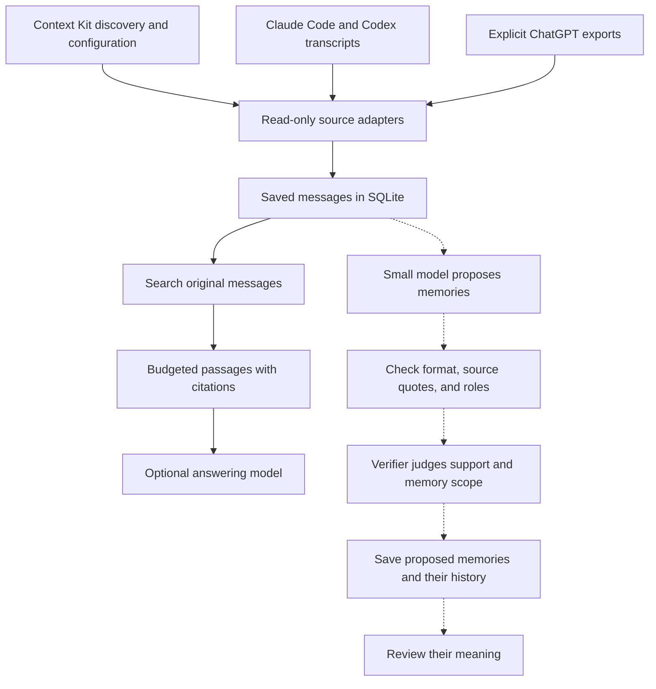

# TraceMem

TraceMem searches past conversations and returns the original messages, with
citations. The research goal is to train a small model to extract useful facts
and decisions without losing who said them, when they applied, or how certain
the speaker was.

Someone might say, “I might try SQLite,” then later, “I chose SQLite.” A memory
system must preserve that difference and point back to both messages. The
current tool finds the source; interpreting the change remains experimental.

**The local search tool works today; the trained model is still research.**
The first private SFT continuation raised useful acceptance from 4/7 for both
base and prior to 5/7, but rejected 7/8 unsupported claims versus 8/8 for the
prior adapter and missed its frozen development gate. Labels are provisional
agent judgments with zero human reviewers; no model was selected. The strict
report records a terminal-EOS parsing issue and the separate offline diagnostic.
See the [private SFT results](docs/private-sft-results.md).

An earlier Qwen3-4B verifier continuation on fictional data also missed its
overall criteria: unsupported rejection improved from 18/24 to 23/24 and
useful-memory retention from 5/12 to 10/12 compared with the previous adapter,
but supported retention fell from 24/24 to 22/24. See its [results](docs/verifier-v2-results.md),
separate development and test reports, and [frozen protocol](docs/verifier-v2-protocol.md).

Earlier extraction and verifier experiments remain documented in the
[quote-v4 results](docs/sft-quote-v4-results.md), [quote verifier results](docs/quote-verifier-dev-results.md),
[prompt baseline](docs/quote-baseline-results.md), [quote-v2 results](docs/sft-quote-v2-results.md),
and [pilot results](docs/sft-pilot-results.md). The four extractor runs and
their findings are unchanged by the verifier experiment.

The earlier private inference pilot tested 14 claims against seven real user
messages from one conversation. The continued adapter accepted four of seven
supported memories under the full support-and-eligibility rule, matching the
base model. See the [pilot results](docs/private-pilot-results.md).

The owner permits private training and evaluation on personal Modal. Private
conversations and any adapters trained on them stay out of GitHub. The new
comparison remains a small development diagnostic; it does not establish
extraction, test, or QA quality. See [getting better data](docs/realistic-data.md).

## What works

- Read-only Claude Code and Codex transcript adapters, plus an explicit
  ChatGPT JSON export reader.
- SQLite keeps speaker roles, text versions, and source locations.
- Keyword search (BM25), vector search, or a combination. Default vectors are
  deterministic and need no model download.
- Complete passages keep their citations when packed for a consumer.

## Evidence flow



Conversation facts live in the local evidence store. Training teaches the model
how to judge a claim against the original messages. The current verifier takes
a supplied claim and its evidence, then reports whether it is supported and
whether its subject belongs in personal memory. Extraction and answering are
separate experiments.

The solid arrows show local search; the dotted arrows show model experiments.
Context Kit helps locate sources and stays unchanged. Citations let someone
check the original words; a claim may still be wrong. Proposed memories are
kept for review and do not feed search yet.

## Run the synthetic demo

Python 3.11+ and SQLite with FTS5 are enough. The demo and benchmark use
fictional data and run without an API key or model download.

The demo asks “Where is the quarterly planning meeting?” and retrieves “The
quarterly planning session is in room Juniper, on the fourth floor.” with its
source citation.

```sh
make demo
make benchmark
```

To ingest a local transcript and search its evidence, use a private database
path such as `.local/evidence.sqlite3`:

```sh
mkdir -p .local
PYTHONPATH=src python3 -m tracemem ingest \
  --provider codex --input /path/to/session.jsonl --db .local/evidence.sqlite3
PYTHONPATH=src python3 -m tracemem search \
  --db .local/evidence.sqlite3 --query "What did we decide?" --mode hybrid
```

Keep private source data and derived evidence local. See [data governance](docs/data-governance.md)
for handling rules.

## Read more

- [Project status and design](docs/project-status.md) describes the working
  boundary and research gates.
- [Latest QA review results](docs/qa-controls-review-results.md) reports the
  current fictional review and its limits.
- [Data governance](docs/data-governance.md) covers private-source handling
  and release gates.
- [Documentation index](docs/README.md) groups implementation notes,
  experiments, and validation records.

Code and authored synthetic examples use the [MIT License](LICENSE).
