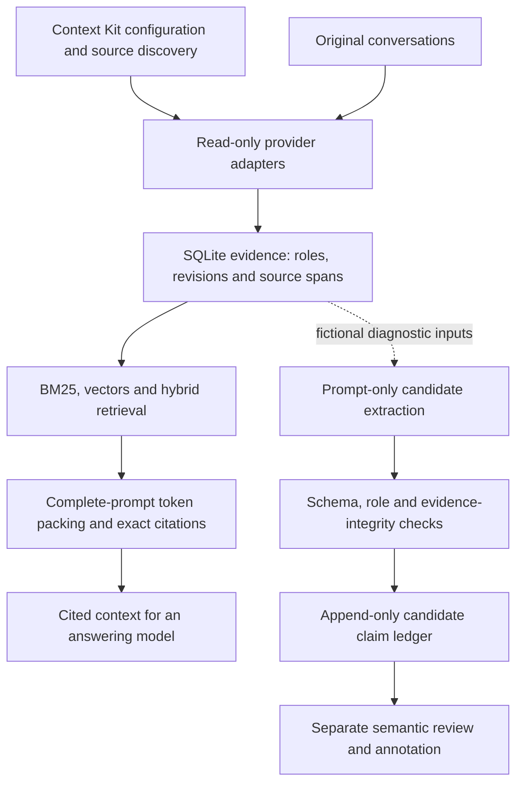

# TraceMem: current prototype and design

Updated 2026-10-15 UTC. The QA controls answer contract passes 556 source tests
(555 passed, one skipped), Ruff on 123 files, mypy on 32 runtime files and 13
installed tests. New private delivery is pending; see the
[validation snapshot](validation-qa-controls-answer-contract.json). The preceding
controls preparation passed exact [CI run 38679061711](https://github.com/1337mus/tracemem/actions/runs/38679061711)
with a valid signature. Earlier review-accounting checks passed 534 source tests
(one skip) and eight installed tests. Check active-cycle for current delivery.
Previously verified QA review tooling delivery:
[`125d366`](https://github.com/1337mus/tracemem/commit/125d3660066cd610e8229fc131714fcb33019cdb).
Its [CI](https://github.com/1337mus/tracemem/actions/runs/38674186708) passed
526 source tests (one skip) and 274 installed tests (two skips). Repository
visibility was verified PRIVATE before that push. Verify live delivery and
worker state in `docs/handoff.md` and ignored `.local/active-cycle.json`.

The working result is an evidence and evaluation system. The specialist model
is still a research objective: no model has been selected or trained.

The offline [answer contract](qa-controls-answer-contract.md) binds 36 fictional
prompts to request SHA-256 `df91a152242ed6b2942802b5957dc7531a58bad3bffce67a284ce4526f90b871`.
Root independently reconstructed all items, accepted a fake receipt, rejected
61 invalid mutations and verified three stop-boundary variants. The 1,024/128
input/output token limits are upper bounds; no input counts are measured. There
is no launcher, scorer or inference, and every receipt is fictional. See its
[validation snapshot](validation-qa-controls-answer-contract.json).

The new frozen offline QA interpretation controls contain six correlated groups
(7 sessions, 22 messages, 12 questions and 36 distinct prompt/cells). Ten
full-source answers are answerable and two are unknown; all 24 support-omitted
and empty cells expect `UNKNOWN`. Full-source answers and prompt-supported
answers remain separate, and shared prompt templates are unchanged. The
always-`UNKNOWN` baseline matches 26/36 prompt expectations but only 6/36
full-source answers. These dev-derived controls have no model outputs, inference,
token measurement, human labels or Gate A evidence. See [controls](qa-interpretation-controls.md)
and the [validation snapshot](validation-qa-interpretation-controls.json).

## What works

- Read-only Claude/Codex transcript adapters and an explicit, fixture-verified
  ChatGPT export reader. Source roles, stable evidence identity, text revisions
  and exact character spans are preserved. Context Kit remains unchanged.
- SQLite evidence storage, indexed FTS5/BM25, vector retrieval and hybrid RRF.
  Deterministic hash vectors work without model downloads. Pinned MiniLM vectors
  have a separate synthetic remote measurement and local replay.
- Exact historical citations, whole-passage context packing with supplied exact
  full-prompt token counts, an append-only candidate claim ledger, structured
  validation, quote anchoring, annotation export and blind review tooling.
- Reproducible fictional demos, separate dev/test extraction reports, raw remote
  receipts, strict provenance checks and tests outside the source checkout.

Context Kit supplies useful configuration and transcript discovery. Its derived
Markdown notes and usage events lack the exact original-message evidence
contract, so TraceMem parses the original records through its own adapters.
See the dated [inventory](context-kit-inventory.md) for sample coverage and limits.
Full private-corpus ingestion has not been performed.

## Design



The solid path is runnable locally without hosted APIs. Model diagnostics use
fictional inputs in bounded Modal jobs; weights and inference stay off the Mac.
The ledger records proposals and lineage. It does not resolve current truth,
perform source erasure, or automatically accept a claim as semantically supported.
A valid citation proves source identity and quote integrity, not entailment.

## What the measurements show

| Evidence | Observed result | Scope |
| --- | --- | --- |
| MiniLM retrieval | Recall@5 1.0 on 14 answerable queries; 0/3 unknown abstentions | 40 fictional records; no generalization or calibration claim |
| Two-model extraction | Qwen emitted 83 schema-valid candidates across 48 cases; Phi emitted one | Separate 24-case dev/test partitions; substantial schema, attribution and temporal failures remain |
| Token-budget retrieval | At 128/256/512/1,024 tokens, hybrid retained authored labels at macro recall 0/.125/.75/1 | Six agent-authored dev scenarios; four answerable and two unknown exclusions per group |
| Matched-budget answering diagnostic | Every group: 0/4 answerable literal matches, 2/2 unknown matches; 479 generated tokens over 46 prompts | Six fictional dev scenarios; verbose paraphrases occur, so this is not semantic accuracy |

See [model comparison](experiments-scenarios.md),
[token replay](qa-contrast-token-replay.md) and
[answering results](qa-contrast-answer-results.md) for exact denominators and receipts.
Model outputs and agent judgments are not independent human ground truth.

## Current work and remaining gates

Phase 0 inventory and Phase 1 runnable infrastructure are complete. The next
bounded diagnostic completed one [source-free answering call](qa-contrast-answer-runner.md).
It used a remote T4, 23,533 input tokens and 479 generated tokens. Raw responses
were preserved and independently checked against all 72 comparison cells.
The app stopped with zero tasks. The separately reviewed analysis passes full
checks: 520 tests (one skip), Ruff and mypy, plus six installed tests. Its source,
fictional receipts and final report are included here. Source and installed
report bytes match exactly; active-cycle records the newest delivery and CI.

A separate [qualitative QA review workflow](qa-contrast-answer-review.md) prepares
46 unique prompt/source/answer tasks across all 72 condition mappings. It
separates correctness against the full source from support in the actual prompt.
Root checks passed 526 tests (one skip), lint/type checks and six installed
tests; actual source/copied exports match byte-for-byte. One self-attested agent
completed all 46 reviews: source answer 32 correct, 13 incorrect, 1 uncertain;
prompt support 38 supported, 7 unsupported, 1 uncertain. Root reread all tasks
and audited rationales, agreeing on 45 and making one stricter, unblinded
derivative change: root counts are 32 correct, 14 incorrect, 38 supported and
8 unsupported. This is not an independent second sample, consensus or human
label set. The frozen literal report remains unchanged. See [review results](qa-contrast-review-results.md)
and [review accounting](qa-contrast-review-accounting.md).

Gate A remains unmet: there are zero independent human labels and insufficient
independently validated, legally reviewed held-out scenarios. Training,
model selection, broad memory benchmarks, privacy-reviewed release and any
research-success claim remain ahead. Context Kit, original conversations and
machine-local context stay read-only; private data stays local.

To try the current fictional end-to-end path:

```sh
make demo PYTHON=.venv/bin/python
```
