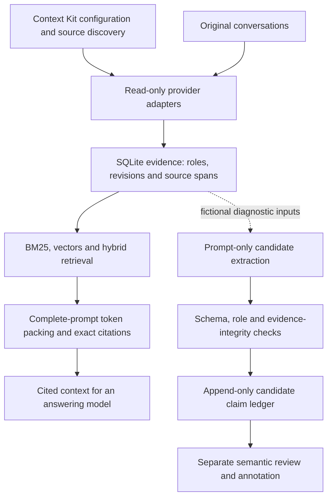

# TraceMem: current prototype and design

Updated 2026-10-15 UTC. Latest verified delivery:
[`d8d0847`](https://github.com/1337mus/tracemem/commit/d8d0847c058559aff791fae70a0ed757c7510dfa).
Its [CI](https://github.com/1337mus/tracemem/actions/runs/38668432855) passed
502 source tests (one skip) and 250 installed tests (two skips). Repository
visibility was verified PRIVATE before that push. Verify live delivery and
worker state in `docs/handoff.md` and ignored `.local/active-cycle.json`.

The working result is an evidence and evaluation system. The specialist model
is still a research objective: no model has been selected or trained.

## What works

- Read-only Claude/Codex transcript adapters and an explicit, fixture-verified
  ChatGPT export reader. Source roles, stable evidence identity, text revisions
  and exact character spans are preserved. Context Kit remains unchanged.
- SQLite evidence storage, indexed FTS5/BM25, vector retrieval and hybrid RRF.
  Deterministic hash vectors work without model downloads. Pinned MiniLM vectors
  have a separate synthetic remote measurement and local replay.
- Exact historical citations, whole-passage context packing with supplied exact
  full-prompt token counts, an append-only candidate claim ledger, structured
  validation, quote anchoring, annotation export and blind review tooling.
- Reproducible fictional demos, separate dev/test extraction reports, raw remote
  receipts, strict provenance checks and tests outside the source checkout.

Context Kit supplies useful configuration and transcript discovery. Its derived
Markdown notes and usage events lack the exact original-message evidence
contract, so TraceMem parses the original records through its own adapters.
See the dated [inventory](context-kit-inventory.md) for sample coverage and limits.
Full private-corpus ingestion has not been performed.

## Design



The solid path is runnable locally without hosted APIs. Model diagnostics use
fictional inputs in bounded Modal jobs; weights and inference stay off the Mac.
The ledger records proposals and lineage. It does not resolve current truth,
perform source erasure, or automatically accept a claim as semantically supported.
A valid citation proves source identity and quote integrity, not entailment.

## What the measurements show

| Evidence | Observed result | Scope |
| --- | --- | --- |
| MiniLM retrieval | Recall@5 1.0 on 14 answerable queries; 0/3 unknown abstentions | 40 fictional records; no generalization or calibration claim |
| Two-model extraction | Qwen emitted 83 schema-valid candidates across 48 cases; Phi emitted one | Separate 24-case dev/test partitions; substantial schema, attribution and temporal failures remain |
| Token-budget retrieval | At 128/256/512/1,024 tokens, hybrid retained authored labels at macro recall 0/.125/.75/1 | Six agent-authored dev scenarios; four answerable and two unknown exclusions per group |
| New answering preparation | 72 comparison cells map to 46 prompts, using 23,533 unique input tokens | Source-only payload; references/scoring isolated; no answers measured yet |

See [model comparison](experiments-scenarios.md),
[token replay](qa-contrast-token-replay.md) and
[request preparation](qa-contrast-requests.md) for exact denominators and receipts.
Model outputs and agent judgments are not independent human ground truth.

## Current work and remaining gates

Phase 0 inventory and Phase 1 runnable infrastructure are complete. The next
bounded implementation is a [source-free answering runner](qa-contrast-answer-runner.md)
for the frozen 46 prompts. Root review and full checks pass: 514 tests (one
skip), Ruff and mypy. All 12 installed tests and exact offline CLI replay pass.
Private delivery is being finalized before one reviewed, synthetic-only Modal
call. The configured generation
bound is 5,888 tokens; no new answers have been measured yet.

Gate A remains unmet: there are zero independent human labels and insufficient
independently validated, legally reviewed held-out scenarios. Training,
model selection, broad memory benchmarks, privacy-reviewed release and any
research-success claim remain ahead. Context Kit, original conversations and
machine-local context stay read-only; private data stays local.

To try the current fictional end-to-end path:

```sh
make demo PYTHON=.venv/bin/python
```
