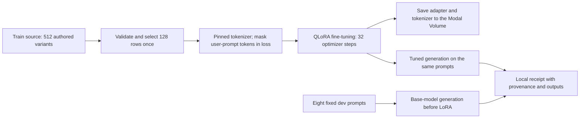

# SFT pilot: scope, execution, results, and limits

Updated: 2026-10-15

This is a bounded supervised fine-tuning (SFT) experiment for the fiction-only, agent-authored corpus in `datasets/sft-pilot/`. The complete train source has 512 rows across 32 scenario families (16 correlated variants per family), including 128 explicit abstentions across eight families. Offline preparation validates the data and selects 128 rows once with seed 17; the remote worker consumes that ordered sample without resampling. The dev source has 32 cases across eight families, but evaluation uses one prompt from the first (`V01`) variant of each family, for eight fixed prompts. A separate private 32-case test split is excluded from preparation, hashes, and remote inputs.

The authorized run completed on 2026-10-15. It proves the bounded QLoRA execution and artifact path worked; the matched development comparison produced zero exact claim matches for both base and tuned outputs. See the [pilot results](sft-pilot-results.md) for metrics, failure examples, validation, and an offline replay command.



The training target is `Qwen/Qwen3-4B` at revision `1cfa9a7208912126459214e8b04321603b3df60c`. Training uses 4-bit NF4 QLoRA with BF16 compute, LoRA rank 16 / alpha 32 / dropout 0.05, and 32 AdamW steps at learning rate `2e-4`. Microbatch size is one with gradient accumulation four. User-prompt tokens are masked from the loss; only assistant targets are supervised. Generation is deterministic and limited to 1,024 new tokens per dev prompt. The worker records base outputs before attaching LoRA, then tuned outputs from the same eight prompts. Only adapter and tokenizer artifacts are saved; base model weights are not copied to the volume.

Offline preparation has no Modal or ML-runtime imports and prints hashes and row counts only. It binds the job to both data files, the builder and support modules, the launch helper, resource settings, and dependency pins. A launch requires the exact current job hash and a new local receipt path. Training also requires a unique lowercase run ID; the worker reserves a fresh child directory beneath the mounted volume so a repeated ID cannot overwrite an existing run. The remote image mounts exactly `training/train_sft.py` and `training/remote_sft.py`; the local job may hash additional support files without uploading them.

These commands only prepare a job and print its summary; they do not install dependencies, download model weights, or start Modal work:

```sh
PYTHONPATH=src:. .venv/bin/python experiments/modal_sft.py --mode preflight
PYTHONPATH=src:. .venv/bin/python experiments/modal_sft.py --mode train --run-id pilot-plan-01
```

The following records the launch interface used for this experiment. The run is complete; these commands are not a request or plan for another launch. Future runs must stay within the owner's authorized scope, review the exact payload, verify fresh personal workspace and inventory, and use new run IDs and receipt paths.

```sh
PYTHONPATH=src:. .venv/bin/python experiments/modal_sft.py \
  --mode train --run-id <unique-run-id> --launch \
  --approve-job-sha256 <job-sha256-from-offline-summary> \
  --output /path/to/new-receipt.json
```

| Stage | Fixed request |
| --- | --- |
| Tokenizer preflight | CPU `(2, 2)`, 4,096 MiB memory, 600-second timeout |
| Training | One A10G, CPU `(4, 4)`, 32,768 MiB memory, 3,600-second timeout |
| Both stages | Startup timeout 300 seconds, at most one container, no buffer or retries, serialized and single-use containers, 2-second scaledown window |
| Remote image | Pinned Transformers 4.51.3, Tokenizers 0.21.1, Jinja2 3.1.6, Hugging Face Hub 0.30.2, Safetensors 0.5.3; training additionally pins Torch 2.7.1, Accelerate 1.6.0, PEFT 0.15.2, and bitsandbytes 0.45.5 |

At preparation time, one full training execution hour was estimated at **$1.545984**, plus startup/other provider overhead and volume storage. The one-hour timeout bounds the requested compute window; it is not a provider billing cap. The $5 amount was the experiment owner's target budget, not an enforced limit. The app was restricted to the owner's private personal Modal workspace. The observed execution-resource estimate and billing caveat are recorded in the [results report](sft-pilot-results.md); actual provider billing is unavailable.

The corpus labels are agent-authored and have zero human reviewers. The variants share scenario templates and labels, so 512 rows are not 512 independent observations. The labels are provisional, and the eight-prompt dev set is only a small diagnostic. Gate A has not been met. This completed run shows that the training path executed and produced an adapter; it does not establish annotation validity, generalization, model quality, or production readiness.

## Verified preparation

All 693 active source tests passed, with one optional skip. The full check then
stopped on formatting; after four formatting-only fixes, all 62 SFT tests and
the repository lint, format, and type checks passed. The actual Modal CPU
preflight completed in 24 seconds. All 128 selected rows fit the 2,048-token
training limit, with 140,995 input tokens and 14,167 supervised tokens. The
longest row has 1,436 tokens. Every prompt is masked from loss, and terminal EOS
is supervised. All eight dev prompts fit their generation budget. No weights
or GPU work ran during preparation. See the [preparation validation record](validation-sft-pilot-preparation.json). Post-training source checks and evaluation are summarized in the [results report](sft-pilot-results.md).
